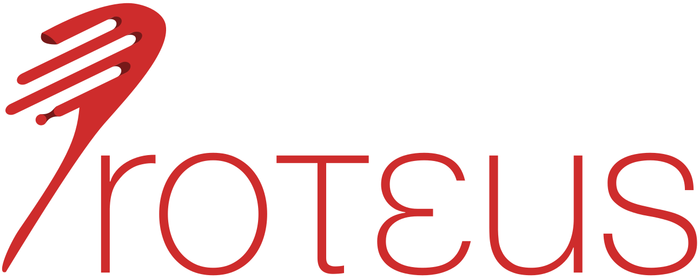

Proteus: a DBMS for taming heterogeneity
================
Proteus is a database engine designed for today's heterogeneous environments. Proteus adapts to variable data, hardware and workloads through a combination of GPU acceleration, data virtualization, and adaptive scheduling.

For more information on the project checkout the website [proteusdb.com/](https://proteusdb.com/). Further documentation on building, running and contributing can be found in the [docs folder](docs/README.md).

Proteus is actively developed by members of EPFL's [DIAS Lab](https://www.epfl.ch/labs/dias/).

## Paper artifact

The `decom_op` branch contains the code and reproducibility workflows for:

### Tile-Based Decompression in Compiled GPU Engines

Antonio Boffa, Ananya Gupta, Hamish Nicholson, and Anastasia Ailamaki

- Categories: `cs.DB`, `cs.DC`
- Comments: 15 pages, 6 figures, 3 tables; accepted to PVLDB Vol. 20
- ACM classification: `H.2.4`, `E.4`, `D.3.4`
- Journal reference: *Proceedings of the VLDB Endowment* 20 (2026)
- DOI: [10.14778/3849423.3849445](https://doi.org/10.14778/3849423.3849445)

The code and bare-metal A100 workflow for the CB2T experiments are documented
in [`tools/workloads/README.md`](tools/workloads/README.md).

The HeavyDB and Sirius comparison workflows are documented in
[`tools/competitors/README.md`](tools/competitors/README.md).
