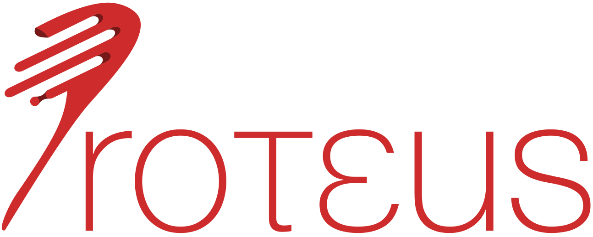

Proteus: a DBMS for taming heterogeneity
================
Proteus is a database engine designed for today's heterogeneous environments. Proteus adapts to variable data, hardware and workloads through a combination of GPU acceleration, data virtualization, and adaptive scheduling.

For more information on the project checkout the website [proteusdb.com/](https://proteusdb.com/). Further documentation on building, running and contributing can be found in the [docs folder](docs/README.md).

Proteus is actively developed by members of EPFL's [DIAS Lab](https://www.epfl.ch/labs/dias/).

## Paper artifact

The `decom_op` branch contains the code and reproducibility workflows for:

### Tile-Based Decompression in Compiled GPU Engines

Antonio Boffa, Ananya Gupta, Hamish Nicholson, and Anastasia Ailamaki

- Published in *Proceedings of the VLDB Endowment*, 20(2): 352-366, 2026.
- [Paper page](https://www.vldb.org/pvldb/volumes/20/paper/Tile-Based%20Decompression%20in%20Compiled%20GPU%20Engines) | [PDF](https://www.vldb.org/pvldb/vol20/p352-boffa.pdf)
- DOI: [10.14778/3849423.3849445](https://doi.org/10.14778/3849423.3849445)

The code and bare-metal A100 workflow for the CB2T experiments are documented
in [`tools/workloads/README.md`](tools/workloads/README.md).

The HeavyDB and Sirius comparison workflows are documented in
[`tools/competitors/README.md`](tools/competitors/README.md).

## Citation

If you use this code or build on this work, please cite:

```bibtex
@article{BoffaGNA26,
  author  = {Antonio Boffa and Ananya Gupta and Hamish Nicholson and Anastasia Ailamaki},
  title   = {Tile-Based Decompression in Compiled {GPU} Engines},
  journal = {Proceedings of the VLDB Endowment},
  volume  = {20},
  number  = {2},
  pages   = {352--366},
  year    = {2026},
  doi     = {10.14778/3849423.3849445},
  url     = {https://doi.org/10.14778/3849423.3849445}
}
```
